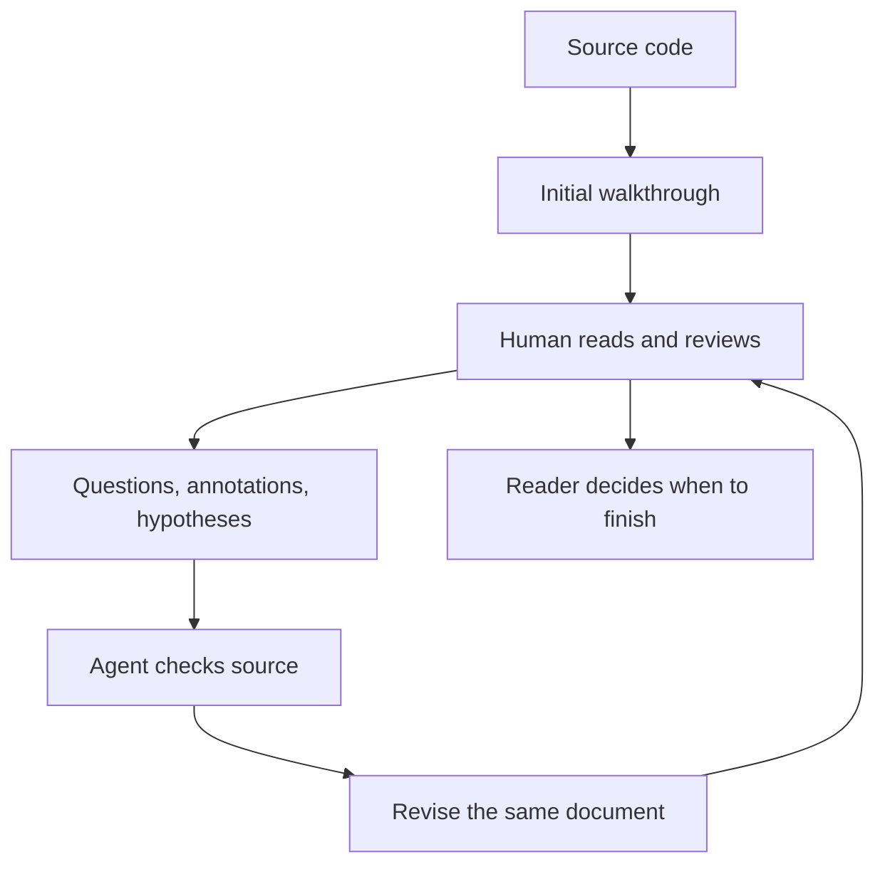

# interactive-code-review

**AI-assisted code review, not AI-delegated code review.**

An Agent Skill for reviewing code with AI while retaining human understanding and judgment.

[中文 Skill](translations/SKILL.zh-CN.md) · [Skill instructions](SKILL.md) · [Illustrative example](examples/retry-loop.md)

## Why?

AI can generate code faster than humans can understand it. Automated reviews can find defects, but they do not necessarily help you build a mental model of the implementation. Ordinary chat can help, yet useful explanations get scattered across conversation history.

Interactive Code Review uses a single evolving document to preserve that understanding. Instead of asking an agent to guess your knowledge level, let your questions determine where the document needs more detail.

## Install

Using the [skills CLI](https://skills.sh/):

```sh
npx skills add Vehshanaan/interactive-code-review
```

For a global installation, add `-g`. Alternatively, copy [SKILL.md](SKILL.md) into a skill directory named `interactive-code-review` following your agent's installation instructions. The skill uses the open [Agent Skills](https://agentskills.io/) format. It is designed for agents that can read source and edit documents; behavior across hosts has not yet been systematically tested.

## How it works



1. Ask the agent to use interactive-code-review on a file, module, behavior or diff.
2. Confirm whether to create a document or continue an existing one.
3. Read the walkthrough, add annotations or ask questions in chat.
4. The agent checks the source and integrates clarifications into the same document.
5. Repeat as needed. Resume later using the latest document and source.

For example:

> Use interactive-code-review to help me understand this module.

> I added three questions to the walkthrough. Please address them.

> Why does this function hold the mutex while waiting?

> Continue reviewing using this existing document.

## What makes it different?

| Approach | Main outcome |
| --- | --- |
| Automated code review | Findings and suggested fixes |
| Code documentation | A description of code |
| Chat with code | Answers in a conversation |
| Interactive Code Review | A persistent, reader-adapted explanation supporting human review |

The document's granularity emerges from reader feedback. Sections need not be equally detailed. Clarifications are integrated into the original prose rather than appended as a chat transcript, and a new document is never created without the reader's authorization.

## Example

See [reviewing a retry loop](examples/retry-loop.md) for a small, constructed example showing the initial explanation, reader feedback and the evolved document.

## Scope and safety

The skill has no scripts or runtime dependencies of its own. It instructs the agent to modify the walkthrough rather than the reviewed source by default. Understanding code is not proof of correctness, and ending the review is not an approval decision.

## Feedback

This is an early release. Feedback from real review sessions is welcome, particularly reports of agents recreating documents, failing to integrate feedback, losing the overall thread, or behaving differently across hosts. Please share sanitized examples in [GitHub Issues](https://github.com/Vehshanaan/interactive-code-review/issues).

## License

[MIT](LICENSE).
